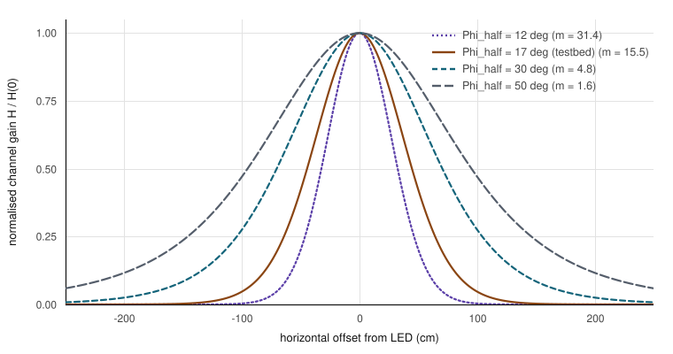
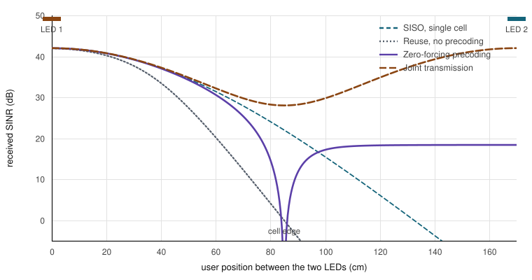
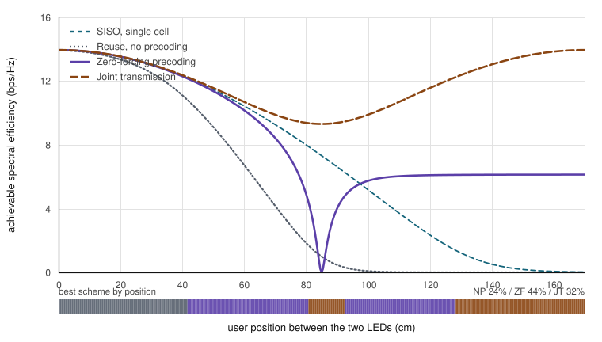
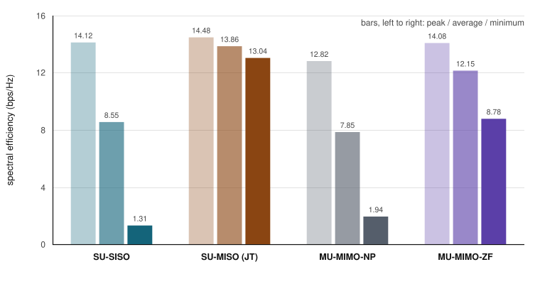

# Multi-cell VLC Testbed

**Software-defined visible light communication: GNU Radio + USRP, OFDM over phosphor-converted white LEDs, and coordinated multi-point transmission across two overlapping cells.**

[](https://doi.org/10.1109/CSNDSP68462.2026.11654482)
[](https://doi.org/10.1109/CSNDSP68462.2026.11654482)
[](LICENSE)
[](tools/make_figures.py)

This repository accompanies:

> R. Mummadi, X. Zhang, A. A. Dowhuszko, K. G. Rallis, R. Wichman, and J. Hämäläinen,
> **"Experimental Evaluation of Multi-User Multi-Point Transmission Schemes in Multi-cell VLC Systems,"**
> *Proc. 15th Int. Symposium on Communication Systems, Networks and Digital Signal Processing (CSNDSP)*, 2026.
> DOI: [10.1109/CSNDSP68462.2026.11654482](https://doi.org/10.1109/CSNDSP68462.2026.11654482)

**→ [Interactive companion page](docs/index.html)** — every figure below, but runnable: drag the mounting height, the LED beam angle, the CSI error, and watch the region map redraw.

---

## Contents

- [The problem](#the-problem)
- [How the channel behaves](#how-the-channel-behaves)
- [Getting bits onto light](#getting-bits-onto-light)
- [Two cells, three schemes](#two-cells-three-schemes)
- [Results](#results)
- [The testbed](#the-testbed)
- [Repository layout](#repository-layout)
- [Reproducing the figures](#reproducing-the-figures)
- [Citing](#citing)
- [License and copyright](#license-and-copyright)

---

## The problem

Indoor lighting is already a dense, overlapping grid of emitters. Modulate those LEDs fast enough to carry data and you inherit that grid as your cell plan — along with its worst property: every luminaire spills into its neighbour's cell.

Uniform illumination *requires* densely packed luminaires, so coverage areas overlap by design. That overlap is desirable for lighting and destructive for communication. A user standing between two lamps receives two signals of comparable strength, so the second one is not a weak nuisance but a co-equal competitor.

This work builds the link on real hardware, measures what that overlap costs, and fixes it two different ways — both using only **linear processing at the transmitter**, so the receiver stays a photodiode and a transimpedance amplifier.

**The headline result is a map, not a number.** With the LEDs 170 cm apart, no single scheme wins everywhere:

| Region | Share of service area | Best scheme |
|---|---:|---|
| Cell centre | 22% | Plain reuse / SISO |
| Inner cell edge | 46% | Zero-forcing precoding |
| Outer cell edge | 32% | Joint transmission |

---

## How the channel behaves

A phosphor-converted white LED radiates as a **Lambertian emitter**. With the detector's field-of-view angle $\Psi_c$ taken into account, the channel gain is pure geometry:

$$
H = \frac{(m+1)A}{2\pi d^2}\cos^{m}(\phi)\, T_s(\psi)\, g(\psi) \cos(\psi),
\qquad 0 \le \psi \le \Psi_c
$$

where $m = -\ln 2\,/\,\ln(\cos \Phi_{1/2})$ is the Lambertian order, $\Phi_{1/2}$ the LED half-intensity angle, $A$ the detector's active area, $d$ the link distance, and $\phi, \psi$ the irradiance and incidence angles. Outside $\Psi_c$ the gain is **zero** — a hard edge, not a roll-off.

With the LED pointing straight down and the detector flat on the floor, both angles collapse to the same one and the gain falls as $h^{m+1}/d^{m+3}$:

<picture>
  <source media="(prefers-color-scheme: dark)" srcset="figures/channel-gain-dark.svg">
  
</picture>

A narrow beam builds a tight, bright cell with a steep skirt: good for isolation, bad for coverage. The testbed LEDs sit at $\Phi_{1/2} \approx 17°$, giving $m \approx 15.5$.

**Model validation.** The Lambertian prediction tracks the measured gain closely in the vertical plane across the whole evaluated range. Horizontally it tracks to about 70 cm, beyond which the measurement runs *above* the model — wall reflections and ambient illumination contribute power that a pure line-of-sight model does not predict.

---

## Getting bits onto light

The modulation is **intensity modulation with direct detection (IM/DD)**: brightness carries the waveform, and the detector responds to received optical power. There is no phase to recover, and no negative light.

$$
r(t) = R\,h\,x(t) + n(t)
$$

OFDM turns a frequency-selective channel into a stack of flat subcarriers, but it produces a complex bipolar signal. Optical OFDM normally forces a real output using Hermitian symmetry, spending half the spectrum to do it. **This testbed takes the other route:** a passband scheme that upconverts the complex baseband onto an intermediate frequency, yielding a real-valued waveform without the symmetry constraint. A DC bias then lifts it above zero to drive the LED.

That bias is the central design tension. Too little and the negative excursions clip at zero; too much and the LED leaves its linear region while optical power is spent on a constant term carrying no information. OFDM's high PAPR makes the window narrow — hence the high-power amplifier held in its linear region.

For a single link the SNR follows straight from the channel gain, $\mathrm{SNR}_{\text{SISO}} = (G R P_{tx} h)^2 / \sigma_n^2$, and the error rate is textbook AWGN:

$$
\mathrm{BER}_{\mathrm{QPSK}} = \tfrac{1}{2}\,\mathrm{erfc}\!\left(\sqrt{E_b/N_0}\right)
\qquad
\mathrm{BER}_{M\text{-QAM}} \approx \tfrac{3}{2(M-1)}\,\mathrm{erfc}\!\left(\sqrt{\tfrac{3}{M-1}\cdot\tfrac{E_b}{N_0}}\right)
$$

<picture>
  <source media="(prefers-color-scheme: dark)" srcset="figures/ber-dark.svg">
  
</picture>

Measured against these curves, QPSK follows theory across most of the cell and drops below $10^{-6}$ at short range. **16-QAM holds only inside roughly 90 cm**; beyond that its BER climbs to the order of $10^{-1}$.

> **The phosphor sets the ceiling.** The 150–160 cm single-cell coverage radius is fixed not by the optics and not by the noise, but by the yellow phosphor that converts blue LED emission to white. Its slow response caps the electrical modulation bandwidth. Blue filtering or micro-LEDs are the route past it.

---

## Two cells, three schemes

Add a second identical LED 170 cm away, serving its own user on the same resources. Without precoding:

$$
\mathrm{SINR}_{\text{no-ZF}} = \frac{(G R P_{tx,1} H_{1,1})^2}{(G R P_{tx,2} H_{2,1})^2 + \sigma_n^2}
$$

### Zero-forcing — cancel the interference

With channel state information at the transmitter, precode so that what lands at each detector is only its own data. The precoder is the Moore–Penrose pseudo-inverse:

$$
\mathbf{W}_{\mathrm{ZF}} = \mathbf{H}^{T}(\mathbf{H}\mathbf{H}^{T})^{-1}
\quad\Longrightarrow\quad
\mathbf{H}_{\text{eff}} = \mathbf{H}\mathbf{W} = \mathbf{I}_2
$$

Columns are normalised afterwards so each LED stays inside its permitted intensity range — this is a lighting fixture, and it has a brightness it is supposed to maintain.

ZF carries a structural cost. As the two channel rows become similar the matrix approaches singularity, the precoder norm grows, and after normalisation the useful signal shrinks. **That noise enhancement is worst exactly at the midpoint**, where the two gains are equal.

### Joint transmission — use the interference

The alternative inverts the premise. Both LEDs send the *same* stream and the optical powers add constructively:

$$
\mathrm{SNR}_{\mathrm{JT}} = \frac{(G R P_{tx,1} H_{1,1} + G R P_{tx,2} H_{2,1})^2}{\sigma_n^2}
$$

At the midpoint, where each lamp alone is weakest, two equal contributions add to roughly four times the power. The interference becomes signal. The cost: JT is single-user, so everyone else must be scheduled orthogonally.

<picture>
  <source media="(prefers-color-scheme: dark)" srcset="figures/sinr-vs-position-dark.svg">
  
</picture>

The three curves trade places in a fixed order:

1. **Near the lamp** — the interferer is ~20 dB down. Plain reuse is fine; precoding only costs power.
2. **Inner cell edge** — no-precoding collapses. Zero-forcing holds a usable level.
3. **Approaching the midpoint** — the channel matrix turns ill-conditioned, the precoder norm explodes, and ZF falls off too. Joint transmission, the flattest curve throughout, comes out on top.

---

## Results

<picture>
  <source media="(prefers-color-scheme: dark)" srcset="figures/spectral-efficiency-dark.svg">
  
</picture>

**A note on how the winner is chosen.** Compared link by link, joint transmission wins at *every* position by construction — two lamps driving one stream cannot be worse than one. The comparison that carries information counts throughput **per cell**: reuse and ZF serve two users simultaneously, JT serves one and the others wait their turn. The band above uses that accounting; the [interactive page](docs/index.html) lets you switch between the two.

### Measured spectral efficiency

<picture>
  <source media="(prefers-color-scheme: dark)" srcset="figures/measured-results-dark.svg">
  
</picture>

| Transmission scheme | Peak (bps/Hz) | Avg. (bps/Hz) | Min. (bps/Hz) |
|---|---:|---:|---:|
| SU-SISO | 14.12 | 8.55 | 1.31 |
| SU-MISO (joint transmission) | **14.48** | **13.86** | **13.04** |
| MU-MIMO-NP (no precoding) | 12.82 | 7.85 | 1.94 |
| MU-MIMO-ZF (zero-forcing) | 14.08 | 12.15 | 8.78 |

*Table I of the paper. Machine-readable copy: [`data/measured_spectral_efficiency.csv`](data/measured_spectral_efficiency.csv).*

**The minimum column is the one to read.** Single-cell operation bottoms out at 1.31 bps/Hz and plain reuse at 1.94 — both effectively outages. ZF lifts the floor to 8.78. JT lifts it to 13.04, within 1.5 bps/Hz of its own peak: a nearly flat service across the whole 170 cm.

### What it adds up to

- **Transmitter-side linear precoding is enough.** No successive interference cancellation, no receiver-side NOMA. Complexity moves to the lighting controller, which is mains-powered and already networked.
- **ZF and JT fail in opposite directions** — ZF to noise enhancement as $\mathbf{H}$ degenerates, JT to its single-user scheduling cost when the overlap is weak.
- **Position is the scheduling variable.** A practical system needs coarse localisation to pick a scheme — and VLC gives that nearly for free, since channel gain is a direct function of geometry.
- **The open question is handover.** Region boundaries move with mounting height, separation, and detector field of view, so a deployment must learn its own zones rather than inherit these.

---

## The testbed

```
┌─────────────┐   ┌────────────┐   ┌─────┐   ┌──────────┐   ┌───────────┐
│  GNU Radio  │──▶│ USRP-N210  │──▶│ HPA │──▶│ Bias-tee │──▶│ White LED │
│ OFDM + ZF/JT│   │    DAC     │   │     │   │   + DC   │   │  (IM)     │
└─────────────┘   └────────────┘   └─────┘   └──────────┘   └─────┬─────┘
                                                                  │
                              line-of-sight optical channel       │
                              Lambertian · IM/DD                  ▼
┌─────────────┐   ┌────────────┐   ┌──────────────────┐
│  GNU Radio  │◀──│ USRP-N210  │◀──│ PD100A2 + TIA    │
│ sync·FFT·EQ │   │    ADC     │   │ black silicon PD │
└─────────────┘   └────────────┘   └──────────────────┘
```

| Element | Implementation | Why it matters |
|---|---|---|
| Baseband | GNU Radio on host PC | Full control of modulation, precoding, equalisation |
| Converter | USRP-N210 | Real-time TX and RX on one host |
| Drive | HPA in linear region + bias tee | OFDM's high PAPR punishes any non-linearity |
| Transmitter | Phosphor-converted white LED | The bandwidth bottleneck of the whole system |
| Receiver | Black-silicon PD (PD100A2) with built-in TIA | Low cost; keeps receiver processing trivial |
| Waveform | Passband OFDM, QPSK / 16-QAM | Real-valued output without Hermitian symmetry |
| Geometry | 2 LEDs, 170 cm apart, 160 cm high | Deliberately overlapping — the interference *is* the experiment |

The chain is software-defined end to end, which is what makes the scheme comparison fair: same flowgraph, same hardware, only the precoding changes.

---

## Repository layout

```
.
├── README.md
├── LICENSE                 MIT, for the code
├── CITATION.cff            so GitHub shows "Cite this repository"
├── docs/
│   ├── index.html          interactive companion (IEEE two-column format)
│   └── explainer.html      the same content in a wide single-column layout
├── figures/                README figures, light + dark (generated)
├── tools/
│   └── make_figures.py     regenerates figures/ — no dependencies
├── data/
│   └── measured_spectral_efficiency.csv
├── gnuradio/               ← GNU Radio flowgraphs (.grc) and blocks
├── src/                    ← precoding, channel estimation, analysis scripts
└── paper/                  ← accepted manuscript PDF
```

Directories marked ← are placeholders with a README explaining what belongs there. Drop your files straight in.

---

## Reproducing the figures

No dependencies beyond the standard library:

```bash
python3 tools/make_figures.py
```

This prints the model's region split alongside the measured one and writes ten SVGs (five figures × light/dark) into `figures/`. To change the geometry, edit the constants at the top of the script:

```python
SEPARATION_CM = 170.0   # distance between the two LEDs
HEIGHT_CM     = 160.0   # mounting height above the detector plane
PHI_HALF_DEG  =  17.0   # LED half-intensity angle
CSI_ERROR     =   0.12  # residual cross-talk after imperfect estimation
```

The module is importable if you want to build on the model:

```python
from tools.make_figures import schemes_at, best_scheme, spectral_efficiency

s = schemes_at(85.0)                      # user at the midpoint
print(spectral_efficiency(s["jt"]))       # joint transmission, bps/Hz
print(best_scheme(85.0))                  # -> 'jt'
```

> **Model vs. measurement.** The curves in `figures/` and on the interactive page are the analytical model from the paper, calibrated to the experimental geometry. With $\Phi_{1/2} = 17°$ and 12% CSI error it partitions the floor **24 / 44 / 32** against the measured **22 / 46 / 32**. Close enough to say the mechanism is the one the hardware shows; far enough to keep the two labelled separately throughout. Every measured number lives in `data/` and in Table I.

---

## Citing

```bibtex
@inproceedings{mummadi2026vlc,
  author    = {Mummadi, Ramya and Zhang, Xinyu and Dowhuszko, Alexis A. and
               Rallis, Konstantinos G. and Wichman, Risto and H\"am\"al\"ainen, Jyri},
  title     = {Experimental Evaluation of Multi-User Multi-Point Transmission
               Schemes in Multi-cell {VLC} Systems},
  booktitle = {Proc. 15th Int. Symp. on Communication Systems, Networks and
               Digital Signal Processing (CSNDSP)},
  year      = {2026},
  doi       = {10.1109/CSNDSP68462.2026.11654482}
}
```

## Acknowledgment

Supported in part by the Business Finland project **Cloudify-6G** (grant 8822/31/2022).

## License and copyright

Code and figure-generation scripts: [MIT](LICENSE).

The article itself is © 2026 IEEE and is **not** redistributed here. Only the accepted manuscript may be posted, and it carries this notice:

> © 2026 IEEE. Personal use of this material is permitted. Permission from IEEE must be obtained for all other uses, in any current or future media, including reprinting/republishing this material for advertising or promotional purposes, creating new collective works, for resale or redistribution to servers or lists, or reuse of any copyrighted component of this work in other works.

See [`paper/README.md`](paper/README.md) for which version you are allowed to put in `paper/`.
